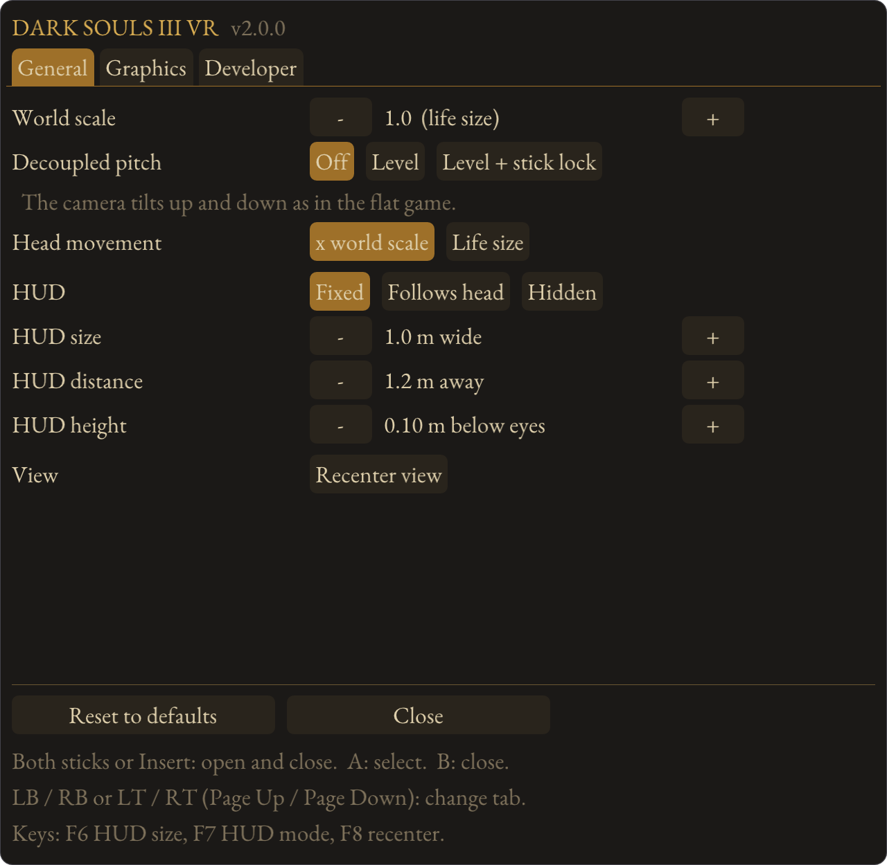
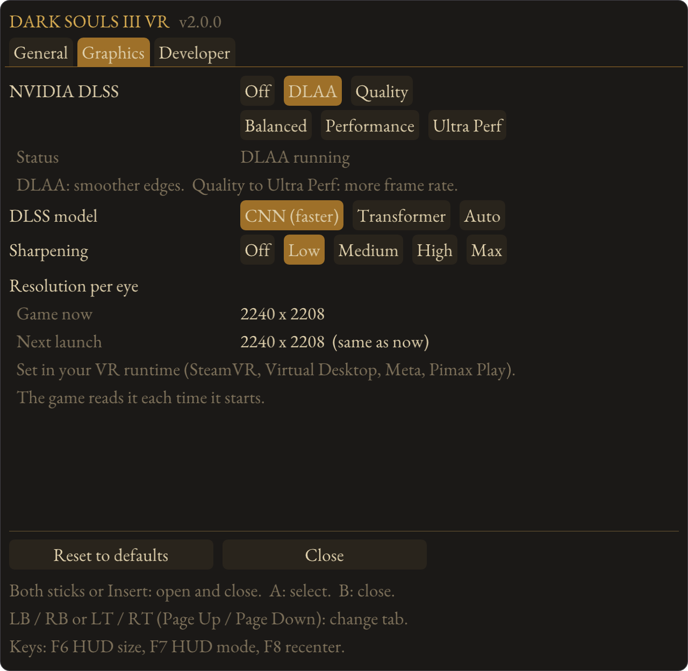
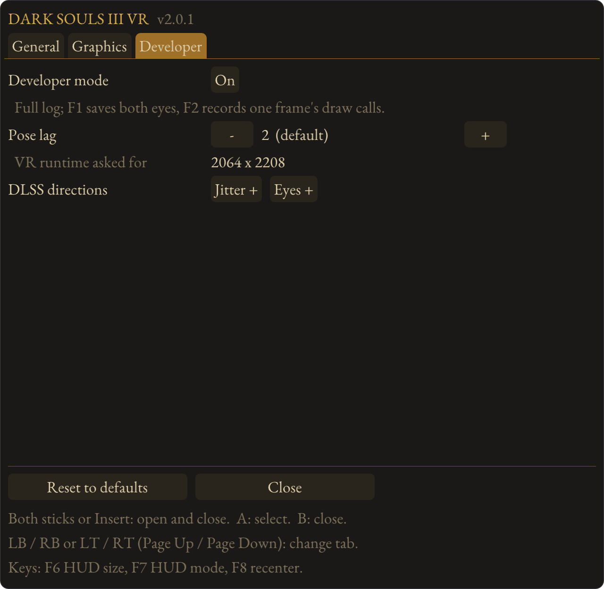

# DS3 VR: Dark Souls III in VR

True stereo VR for Dark Souls III. Both eyes are rendered from the same game frame, so there is no
alternate-eye shimmer. The camera follows your head, the HUD sits on a floating panel you can size
and place, and the game runs at your headset's refresh rate. On NVIDIA RTX graphics cards, DLAA
smooths jagged edges and DLSS upscaling raises the frame rate. You play with a gamepad; there are no
motion controls.

DS3 VR works on top of **Helifax's Dark Souls 3 geo-11 fix**, which does the stereo rendering. This
mod adds the VR side: OpenXR output to your headset, head tracking, the HUD panel, the lock-on
marker in 3D, NVIDIA DLSS for both eyes, and an in-headset menu.

**Download:** see [Releases](../../releases). Each release is a zip you extract into the game's `Game` folder.

## What you need

| | |
|---|---|
| Game | DARK SOULS III on Steam, version 1.15.2 (the current Steam version) |
| VR runtime | An OpenXR runtime set as the active one. Tested on SteamVR, and on Virtual Desktop (VDXR) with a Meta Quest 3; Meta Quest Link and PimaxXR should work but have not been fully tested yet. |
| Headset | Any PC VR headset that runs on that runtime |
| Gamepad | Xbox, or others through Steam Input |
| For DLSS (optional) | An NVIDIA RTX graphics card and a recent driver. Everything else works on any graphics card. |
| Helifax's geo-11 fix | [Dark Souls 3 geo-11 fix](https://helixmod.blogspot.com/2016/04/dark-souls-3-3d-vision-fix.html) by Helifax and masterotaku (21 October 2023 version), which includes the geo-11 3D driver. You do not download it yourself: the install step fetches it from its official host. |

## Install

1. Download the latest DS3 VR zip from [Releases](../../releases) and extract all of it into the game's
   `Game` folder (the one with `DarkSoulsIII.exe`).
2. Run `install-ds3vr.bat` in the `Game` folder. This step exists only because geo-11 and Helifax's
   fix cannot be included in the download: it downloads Helifax's fix from its official host (it asks
   first, and checks that it is the geo-11 version), unpacks it, backs up every file it
   changes into `Game\ds3vr_backup`, switches geo-11 to VR output, and sets the game's graphics
   options for VR.
3. Start your VR runtime, then launch Dark Souls III from Steam as usual.

If the automatic download does not work, download `Dark_Souls_3_geo11_fix.7z` (the geo-11 version,
not the 3D Vision one) from the HelixMod page above, put it in the `Game` folder or your Downloads
folder, and run `install-ds3vr.bat` again.

To update, extract the new zip over the old one; your settings are kept. From 1.0.x to 2.0 you do not
need to run `install-ds3vr.bat` again. To uninstall, run `uninstall-ds3vr.bat`: it restores every file it changed and removes DS3 VR.

## In game

| Action | Gamepad | Keyboard |
|---|---|---|
| Open or close the VR menu | Click both thumbsticks together | Insert |
| Move in the menu | D-pad or left stick | Arrow keys |
| Change menu tab | LB / RB or LT / RT | Page Up / Page Down |
| Select / close | A / B | Enter / Backspace |
| Recenter | Your runtime's recenter, or the menu | F8 |
| HUD size / HUD mode | The menu | F6 / F7 |

The VR menu has three tabs, and every change is saved straight away:

- **General:** world scale (0.25 to 10; 1.0 is life size, higher makes the world smaller with more 3D
  depth), decoupled pitch, head movement, the HUD (fixed, follows your head or hidden; size, distance
  and height) and recenter.
- **Graphics:** NVIDIA DLSS, the DLSS model, sharpening and the resolution readout.
- **Developer:** test settings for troubleshooting. Normal play does not need them.

<p align="center">
  
  
  
</p>

**Decoupled pitch** keeps the horizon level: the right stick never tilts the view up or down, only your
head does. *Level* still lets the stick raise and lower the camera around your character; *Level +
stick lock* ignores the stick's up and down entirely; *Off* is the flat game's camera.

### NVIDIA DLSS

On NVIDIA RTX graphics cards, the Graphics tab offers:

| Setting | What it does |
|---|---|
| Off | The game's own image |
| DLAA | Anti-aliasing at full resolution: edges and fine detail stop shimmering. Costs a little frame rate. Switches straight away. |
| Quality, Balanced, Performance, Ultra Perf | Upscaling: the game renders each eye smaller and DLSS rebuilds it at your headset's resolution, for more frame rate. Applies the next time you start the game. |

Each eye gets its own DLSS pass with its own motion data, worked out from the game's depth and camera
with geo-11's per-eye shift taken out, so the two eyes stay matched. The **DLSS model** can be CNN
(default, fastest) or Transformer. **Sharpening** (Off to Max, AMD's contrast-adaptive sharpening)
works with any setting if the image looks too soft for you. The two NVIDIA files come in the
download's `ds3vr` folder.

### Graphics settings

The install step sets these for you. Keep Motion Blur and Depth of Field off; the rest is up to you.

| Setting | Set to | Why |
|---|---|---|
| Screen Mode | Windowed | The mod sizes the game for your headset |
| Motion Blur | Off | It smears the image every time you turn your head |
| Depth of Field | Off | It blurs whatever you are not looking at in VR |
| Ambient Occlusion | Off | In 3D it can show noise in lit areas |
| Antialiasing | Off | Use DLAA instead (RTX cards); the game's own is not needed |

Do not change the resolution or screen mode in the game's own menu while playing: the game would
rebuild its graphics, which the stereo driver does not survive.

### Resolution and performance

The game renders at the resolution your VR runtime asks for, read when the game starts. To change
it, change the resolution in your runtime (SteamVR, Virtual Desktop, the Meta app or Pimax Play) and
restart the game. The VR menu shows, per eye:

- **Game now:** what the game renders this session
- **Headset gets:** with a DLSS upscaling mode, the size DLSS rebuilds each eye to
- **Next launch:** the size the next launch will use, and whether a restart is needed

The game renders a little wider than the runtime asks for, because DS3 can only draw a symmetric view
and has to cover the wider side of each eye. The height always matches. The frame rate is capped at
your headset's refresh rate.

## Troubleshooting

**The game crashes on start, or renders at the wrong resolution.** DS3 VR reads the render resolution
from your VR runtime as the game starts, and occasionally it does not arrive in time. This mostly
happens on the first launch after installing or updating. Close the game and launch it again; once it
has started correctly it stays correct until the next update or reinstall. The VR menu's Graphics tab
shows whether the next launch will use a different size.

**The game only shows on the monitor.** Your VR runtime is not running, or it is not the active
OpenXR runtime. In SteamVR: Settings > OpenXR > Set SteamVR as OpenXR runtime. Start the runtime
before the game.

**DS3 VR says it is off and asks you to run the install.** Run `install-ds3vr.bat` in the `Game`
folder. If you reinstalled Helifax's fix, run it again.

**The game crashed after changing graphics settings.** Do not change the resolution or screen mode in
the game's own menu while playing. Restart the game; the mod sets the size itself.

**Low frame rate.** Lower the resolution in your VR runtime and restart the game, or pick a DLSS
upscaling mode (Quality or Balanced) on an RTX card and restart. DLAA costs a little frame rate rather
than saving it. Close other VR apps and overlays you are not using. The first launch after installing
can stutter while geo-11 prepares its shaders.

**DLSS options are unavailable.** DLSS needs an NVIDIA RTX graphics card and a recent driver. The
status line under the DLSS setting says why it is off. Check that `ds3vr_ngx.dll`, `nvngx_dlss.dll`
and `NVIDIA_DLSS_LICENSE.txt` are in `Game\ds3vr`. An upscaling mode only applies after a restart.

**The image looks soft.** Try Sharpening on the Graphics tab (Low or Medium is usually enough).

**The view is tilted or off to one side.** Recenter from the VR menu, with F8, or with your runtime's
recenter. If camera pitch from the right stick is uncomfortable, try Decoupled pitch on the General tab.

**Another mod stopped working, or DS3 VR did not load.** DS3 VR is `dinput8.dll` in the `Game`
folder. Other mods that use a `dinput8.dll` there (such as the original DS3 Mod Engine) replace it,
and only one can be installed at a time.

**Windows or your antivirus removed or blocked a file.** Mods that hook into a game are sometimes
flagged. Restore `dinput8.dll` (or `ds3vr\ds3vr-patcher.exe`) from the zip, and add an exception if you
trust the download. Only download DS3 VR from this page's [Releases](../../releases).

## Support

DS3 VR is free. If you enjoy it and want to support more VR mods, you can
[buy me a coffee](https://buymeacoffee.com/scubasteve2365). Thank you!

## Reporting a problem

Open an [issue](../../issues) and attach `Game\ds3vr.log`. If a launch went wrong and you have since
relaunched, attach `Game\ds3vr_prev.log` too: it is the log of the launch before. The first three
minutes of every launch are always logged in full. For problems later in a session, turn on
**Developer mode** on the VR menu's Developer tab first.

## Building

The mod is built with mingw-w64 on Linux or WSL:

```
sudo apt install g++-mingw-w64-x86-64
sh tools/fetch-dlss.sh   # optional: the two DLSS files for the release folder
sh build.sh
```

This produces `build/dinput8.dll` (the mod), `build/ds3vr-patcher.exe` (run by the install and
uninstall batch files) and `build/DS3VR-<version>/`, the release layout that players extract into the
game's `Game` folder. `dist` holds the batch files, the player README and the default settings.

DLSS needs two more files in the release's `ds3vr` folder. `ds3vr_ngx.dll` is a small helper that links
NVIDIA's NGX library, which only exists for Visual Studio, so it is built on GitHub Actions
(`.github/workflows/ngx.yml`, source in `tools/ngx`) and kept on the `ngx-build` branch.
`nvngx_dlss.dll` is NVIDIA's DLSS runtime from the [DLSS SDK](https://github.com/NVIDIA/DLSS).
`tools/fetch-dlss.sh` fetches both, and the release workflow runs it.

| Folder | Contents |
|---|---|
| `src` | The mod: OpenXR output, head tracking, HUD panel, menu, resolution and frame rate handling |
| `installer` | The patcher: unpacks and checks Helifax's fix, patches it for VR, backs up and restores |
| `dist` | Files shipped as they are: install and uninstall batch files, player README, default settings |
| `tools` | A patch test that runs the installer's patches on Helifax's files outside Windows; the NGX helper source; the DLSS fetch script; `menushots`, which renders the menu images in `docs/images` |
| `third_party` | Dear ImGui, MinHook, the OpenXR headers, EB Garamond (menu font, third_party/ebgaramond), and 7-Zip's C decoder |

No files from geo-11 or Helifax's fix are in this repository: their licences do not allow
redistribution. The install step only patches the copy each player downloads.

## Credits

- **geo-11** 3D driver: davegl1234 and the HelixMod team
- **Dark Souls 3 geo-11 fix:** Helifax, updated by masterotaku. Please support them; this mod is built on their work.
- **3Dmigoto:** bo3b, Flugan and DarkStarSword
- **NVIDIA DLSS:** NVIDIA Corporation (DLSS SDK)
- **Sharpening:** AMD FidelityFX Contrast Adaptive Sharpening
- **Inspiration:** Luke Ross's R.E.A.L. VR, praydog's UEVR, and the DS3 DLAA mod on Nexus Mods
- Third-party code: see [THIRD-PARTY-NOTICES.txt](THIRD-PARTY-NOTICES.txt)

## Licence

DS3 VR's own code is under the [MIT licence](LICENSE). geo-11 and Helifax's fix have their own
licences and are not part of this repository. The NVIDIA DLSS files in the release are under NVIDIA's
licence (`NVIDIA_DLSS_LICENSE.txt` in the download), not the MIT licence.
